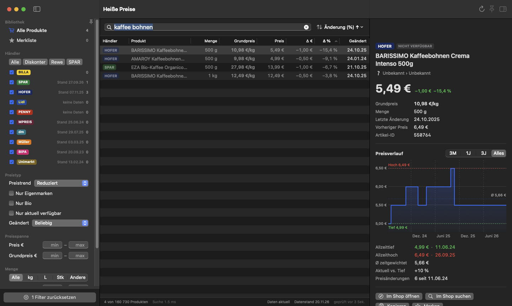

<div align="center">

# 🔥 Heiße Preise für macOS

**Österreichische Supermarktpreise blitzschnell durchsuchen – nativ, lokal, nur mit der Tastatur.**

Ein schneller, nativer Client für die Preisdatenbank [heisse-preise.io](https://heisse-preise.io):
über 160 000 Produkte von 10 Händlern, durchsucht in Millisekunden direkt im Arbeitsspeicher.

[](https://swift.org)
[](#-installation)
[](#-performance)
[](#-architektur)
[](#-performance)


</div>

---

## ✨ Highlights

<table>
<tr>
<td width="50%" valign="top">

### ⚡️ Suche ohne Wartezeit
Jeder Tastenanschlag liefert in **unter 5 ms** neue Ergebnisse – lokal, ohne Netzwerk.
Wörter in beliebiger Reihenfolge, Umlaute egal (`kase` findet *Käse*), `-wort` schließt aus.

</td>
<td width="50%" valign="top">

### ⌨️ Alles per Tastatur
Wie bei Raycast oder Spotlight: tippen, mit `↑` `↓` durch die Liste,
`↩︎` öffnet die Details, `Esc` setzt zurück. Die Maus braucht man nicht.

</td>
</tr>
<tr>
<td valign="top">

### 📈 Preisverlauf mit Swift Charts
Stufen-Chart über die ganze Preisgeschichte, mit Hover-Tooltip,
Allzeittief, Allzeithoch und zeitgewichtetem Durchschnitt.

</td>
<td valign="top">

### 🎛️ Alle Filter von heisse-preise.io
Händler mit Schnellauswahl, Reduziert / Teurer / Tiefstpreis, Eigenmarken, Bio,
Preis- und Grundpreisspanne, Einheit und Packungsgröße, Kategorien – mit Live-Zählern.

</td>
</tr>
<tr>
<td valign="top">

### ⭐ Merkliste & gepinnte Suchen
Stammprodukte merken (`⌘D`) oder ganze Suchen inkl. Filter anpinnen (`⇧⌘D`).
Ein Badge zeigt beim nächsten Öffnen, wie viele Preise sich seither geändert haben.

</td>
<td valign="top">

### 🪶 Nativ & schlank
Nur Apple-Frameworks: SwiftUI, AppKit, Charts, Foundation. Kein WebView,
keine Fremdbibliotheken. Die Daten werden lokal gecacht und nur bei Änderungen neu geladen.

</td>
</tr>
</table>

## 📸 Screenshots

| Übersicht: die neuesten Preisänderungen | Filter: reduzierter Kaffee, sortiert nach Δ % |
|:---:|:---:|
|  |  |

## 🚀 Installation

> [!NOTE]
> Voraussetzungen: **macOS 15 oder neuer** und Swift 6. Die **Command Line Tools reichen**, Xcode ist nicht nötig.

```bash
git clone <repo-url> supermarkt-tracker && cd supermarkt-tracker
./scripts/build-app.sh
open build/HeissePreise.app
```

Beim ersten Start lädt die App ca. **30 MB** Preisdaten und speichert sie unter
`~/Library/Caches/io.heisse-preise.mac`. Danach startet sie aus dem lokalen Cache und
prüft im Hintergrund per ETag, ob es neue Daten gibt.

## ⌨️ Tastenkürzel

| Kürzel | Aktion |
|---|---|
| <kbd>⌘</kbd> <kbd>F</kbd> · <kbd>⌘</kbd> <kbd>K</kbd> | Ins Suchfeld springen |
| <kbd>↑</kbd> <kbd>↓</kbd> · <kbd>⇞</kbd> <kbd>⇟</kbd> | Durch die Ergebnisse navigieren (der Fokus bleibt im Suchfeld) |
| <kbd>↩︎</kbd> · <kbd>⌘</kbd> <kbd>I</kbd> | Details & Preisverlauf öffnen |
| <kbd>Esc</kbd> | Details schließen → Suche leeren → Filter zurücksetzen |
| <kbd>⌘</kbd> <kbd>C</kbd> | Produktname + Preis kopieren (wenn kein Text markiert ist) |
| <kbd>⌘</kbd> <kbd>O</kbd> · <kbd>⇧</kbd> <kbd>⌘</kbd> <kbd>O</kbd> | Im Shop öffnen · im Shop suchen |
| <kbd>⌘</kbd> <kbd>D</kbd> | Produkt merken / entfernen |
| <kbd>⇧</kbd> <kbd>⌘</kbd> <kbd>D</kbd> | Aktuelle Suche anpinnen |
| <kbd>⌘</kbd> <kbd>0</kbd> · <kbd>⇧</kbd> <kbd>⌘</kbd> <kbd>L</kbd> | Alle Produkte · Merkliste |
| <kbd>⌘</kbd> <kbd>R</kbd> · <kbd>⌥</kbd> <kbd>⌘</kbd> <kbd>R</kbd> | Daten aktualisieren · komplett neu laden |
| <kbd>⇧</kbd> <kbd>⌘</kbd> <kbd>R</kbd> | Alle Filter zurücksetzen |
| <kbd>⌃</kbd> <kbd>⌘</kbd> <kbd>1</kbd>–<kbd>9</kbd> | Sortierung wählen |

**Suchsyntax:** `bio vollmilch 1l` findet Produkte, die alle drei Wörter enthalten, in beliebiger Reihenfolge ·
`schokolade -milch` schließt „milch“ aus · Groß-/Kleinschreibung und Akzente spielen keine Rolle.

## 🏎️ Performance

Gemessen mit `swift run -c release pricebench` auf Apple Silicon, mit 160 730 Produkten und 1,27 Mio. Preispunkten:

| Vorgang | Zeit |
|---|---:|
| Katalog + Suchindex aus dem Cache aufbauen | **≈ 0,13 s** |
| Gezielte Suche (`milch`, `kase gouda`, `coca cola -zero`) | **0,6 – 1,1 ms** |
| Breiteste Suche (`a e`, 142 725 Treffer, inkl. Sortierung) | **≈ 3,3 ms** |
| Langsamster Tastenanschlag beim Tippen | **≈ 3 ms** |

<details>
<summary><b>Wie geht das so schnell?</b></summary>

<br>

- **Eigener JSON-Parser** für das komprimierte Feed-Format. Er arbeitet direkt auf den Bytes und legt keine `Any`- oder `NSNumber`-Objekte an.
- **Ein einziger Byte-Puffer** (≈ 7 MB) für alle normalisierten Suchtexte. Das erste Suchwort wird per `memmem` gesucht, parallel auf allen Kernen.
- **Inkrementelle Suche:** Wer weitertippt, durchsucht nur noch die vorherigen Treffer.
- **Filter und Live-Zähler in einem Durchlauf**, über ein flaches Struct-Array ohne Referenzzähler im Hot Path.
- **Vorberechnete Sortier-Permutationen:** Große Ergebnismengen werden in O(n) statt O(n log n) sortiert.
- **`NSTableView` statt SwiftUI `Table`:** Es werden nur die sichtbaren Zeilen gezeichnet. Ein neues Ergebnis bedeutet einen `reloadData()`-Aufruf, egal wie viele Treffer.

</details>

## 🧱 Architektur

```
Sources/
├── PriceCore/                 # UI-unabhängige Engine (Library)
│   ├── Models/                # Store, Product, PricePoint, Kategorien
│   ├── Engine/
│   │   ├── FeedParser.swift   # spezialisierter JSON-Parser
│   │   ├── Catalog.swift      # paralleles Laden → flaches Produkt-Array
│   │   ├── SearchIndex.swift  # gepackter Byte-Index, parallele Suche
│   │   ├── QueryEngine.swift  # Filter, Facetten, Sortierung
│   │   └── PriceStats.swift   # Tief/Hoch/Ø für den Inspector
│   └── Services/
│       └── DataSyncService.swift  # Download, SSD-Cache, ETag-Revalidierung
├── HeissePreise/              # macOS-App (SwiftUI + AppKit)
│   ├── ViewModels/            # AppModel, LibraryStore (Merkliste, Pins)
│   └── Views/                 # Sidebar, ProductTable, Inspector, Chart
└── pricebench/                # Benchmark der Such-Engine
```

**Datenquelle:** `https://heisse-preise.io/data/latest-canonical.<händler>.compressed.json`, ein Feed pro Händler
(Format siehe [`badlogic/heissepreise`](https://github.com/badlogic/heissepreise)).

## ℹ️ Gut zu wissen

> [!IMPORTANT]
> Laut den Feeds werden derzeit **nur die BILLA-Preise laufend aktualisiert.** Für die anderen Händler zeigt die Sidebar
> das Datum des letzten Datenstands. Deren Produkte sind als *nicht verfügbar* markiert und werden abgeblendet angezeigt
> (ausblenden mit „Nur aktuell verfügbar“). Lidl und PENNY liefern momentan leere Feeds.

- **Aktionen** werden wie auf heisse-preise.io erkannt, nämlich an `Preis < vorheriger Preis`. Ein eigenes Aktions-Flag gibt es in den Daten nicht.
- **Schrumpflation** lässt sich nicht erkennen, weil die Feeds nur die aktuelle Packungsgröße enthalten.
- Merkliste und gepinnte Suchen liegen in `~/Library/Application Support/HeissePreise/library.json`.

## 🙏 Danke

Alle Preisdaten stammen von **[heisse-preise.io](https://heisse-preise.io)** von Mario Zechner und den Mitwirkenden.
Dieses Projekt ist ein inoffizieller Client und steht in keiner Verbindung zu den genannten Händlern.
