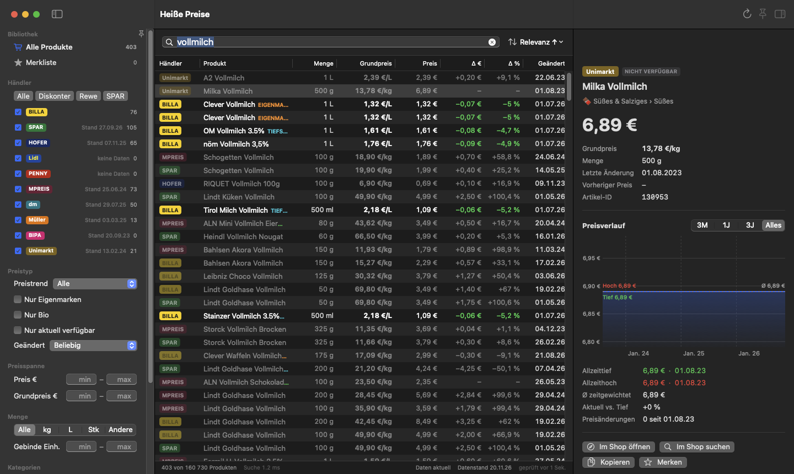
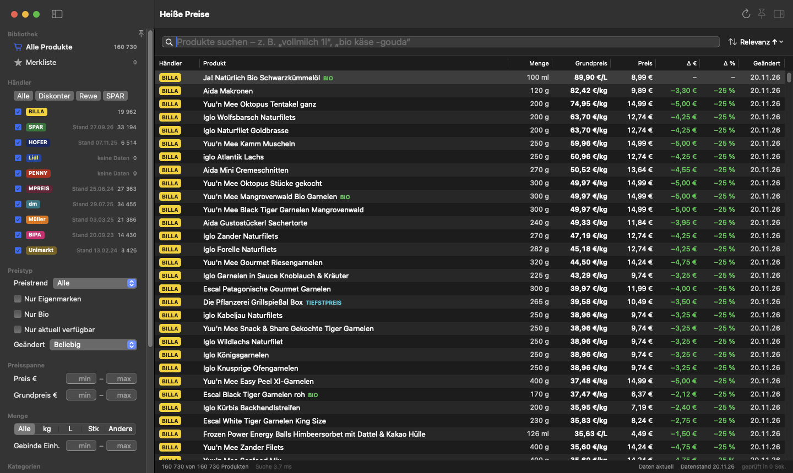

<div align="center">

# 🔥 Heiße Preise for macOS

**Search Austrian supermarket prices instantly: native, local and keyboard-driven.**

A fast native client for the price database [heisse-preise.io](https://heisse-preise.io).
It searches more than 160,000 products from 10 retailers in memory, in milliseconds.

[](https://swift.org)
[](#-installation)
[](#-performance)
[](#-architecture)
[](#-performance)
[](LICENSE)



</div>

---

## ✨ Highlights

<table>
<tr>
<td width="50%" valign="top">

### ⚡️ Search without waiting
Every keystroke returns new results in **under 5 ms**, locally, with no network round trip.
Words match in any order and diacritics don't matter (`kase` finds *Käse*); `-word` excludes a word.

</td>
<td width="50%" valign="top">

### ⌨️ Keyboard first
Works like Raycast or Spotlight: type, move through the list with `↑` `↓`,
open details with `↩︎`, reset with `Esc`. You never need the mouse.

</td>
</tr>
<tr>
<td valign="top">

### 📈 Price history with Swift Charts
A step chart of the full price history with a hover tooltip,
all-time low, all-time high and time-weighted average.

</td>
<td valign="top">

### 🎛️ Every filter from heisse-preise.io
Retailers with quick presets, reduced / more expensive / lowest price, own brands, organic,
price and unit-price ranges, unit and package size, categories, all with live counts.

</td>
</tr>
<tr>
<td valign="top">

### ⭐ Watchlist & pinned searches
Save products you buy regularly (`⌘D`) or pin a whole search including its filters (`⇧⌘D`).
Next time you open it, a badge shows how many prices have changed since.

</td>
<td valign="top">

### 🪶 Native & lean
Only Apple frameworks: SwiftUI, AppKit, Charts and Foundation. No WebView and
no third-party libraries. Data is cached locally and only downloaded again when it changes.

</td>
</tr>
</table>

## 📸 Screenshots

| Overview: the latest price changes | Filters: reduced coffee, sorted by Δ % |
|:---:|:---:|
|  |  |

## 🚀 Installation

> [!NOTE]
> Requirements: **macOS 15 or later** and Swift 6. **The Command Line Tools are enough**; you don't need Xcode.

```bash
git clone <repo-url> supermarkt-tracker && cd supermarkt-tracker
./scripts/build-app.sh
open build/HeissePreise.app
```

On first launch the app downloads about **30 MB** of price data and stores it in
`~/Library/Caches/io.heisse-preise.mac`. After that it starts from the local cache and
uses ETags to check for new data in the background.

## ⌨️ Keyboard shortcuts

| Shortcut | Action |
|---|---|
| <kbd>⌘</kbd> <kbd>F</kbd> · <kbd>⌘</kbd> <kbd>K</kbd> | Jump to the search field |
| <kbd>↑</kbd> <kbd>↓</kbd> · <kbd>⇞</kbd> <kbd>⇟</kbd> | Move through the results (focus stays in the search field) |
| <kbd>↩︎</kbd> · <kbd>⌘</kbd> <kbd>I</kbd> | Open details & price history |
| <kbd>Esc</kbd> | Close details → clear search → reset filters |
| <kbd>⌘</kbd> <kbd>C</kbd> | Copy product name + price (when no text is selected) |
| <kbd>⌘</kbd> <kbd>O</kbd> · <kbd>⇧</kbd> <kbd>⌘</kbd> <kbd>O</kbd> | Open in the shop · search in the shop |
| <kbd>⌘</kbd> <kbd>D</kbd> | Add to / remove from watchlist |
| <kbd>⇧</kbd> <kbd>⌘</kbd> <kbd>D</kbd> | Pin the current search |
| <kbd>⌘</kbd> <kbd>0</kbd> · <kbd>⇧</kbd> <kbd>⌘</kbd> <kbd>L</kbd> | All products · watchlist |
| <kbd>⌘</kbd> <kbd>R</kbd> · <kbd>⌥</kbd> <kbd>⌘</kbd> <kbd>R</kbd> | Refresh data · reload everything |
| <kbd>⇧</kbd> <kbd>⌘</kbd> <kbd>R</kbd> | Reset all filters |
| <kbd>⌃</kbd> <kbd>⌘</kbd> <kbd>1</kbd>–<kbd>9</kbd> | Choose sort order |

**Search syntax:** `bio vollmilch 1l` finds products containing all three words, in any order ·
`schokolade -milch` excludes “milch” · case and accents don't matter.

## 🏎️ Performance

Measured with `swift run -c release pricebench` on Apple Silicon, with 160,730 products and 1.27 million price points:

| Operation | Time |
|---|---:|
| Build catalog + search index from cache | **≈ 0.13 s** |
| Targeted search (`milch`, `kase gouda`, `coca cola -zero`) | **0.6 – 1.1 ms** |
| Broadest search (`a e`, 142,725 hits, including sorting) | **≈ 3.3 ms** |
| Slowest keystroke while typing | **≈ 3 ms** |

<details>
<summary><b>How is it this fast?</b></summary>

<br>

- **A custom JSON parser** for the compressed feed format. It works directly on the bytes and never creates `Any` or `NSNumber` objects.
- **One byte buffer** (≈ 7 MB) holds every normalized search string. The first search word is located with `memmem`, in parallel across all cores.
- **Incremental search:** when you keep typing, only the previous hits are searched again.
- **Filters and live counts in a single pass** over a flat struct array, with no reference counting in the hot path.
- **Precomputed sort permutations:** large result sets are sorted in O(n) instead of O(n log n).
- **`NSTableView` instead of SwiftUI `Table`:** only visible rows are drawn, so a new result set is one `reloadData()` call no matter how many hits there are.

</details>

## 🧱 Architecture

```
Sources/
├── PriceCore/                 # UI-independent engine (library)
│   ├── Models/                # Store, Product, PricePoint, categories
│   ├── Engine/
│   │   ├── FeedParser.swift   # specialized JSON parser
│   │   ├── Catalog.swift      # parallel loading → flat product array
│   │   ├── SearchIndex.swift  # packed byte index, parallel search
│   │   ├── QueryEngine.swift  # filters, facets, sorting
│   │   └── PriceStats.swift   # low/high/average for the inspector
│   └── Services/
│       └── DataSyncService.swift  # download, disk cache, ETag revalidation
├── HeissePreise/              # macOS app (SwiftUI + AppKit)
│   ├── ViewModels/            # AppModel, LibraryStore (watchlist, pins)
│   └── Views/                 # sidebar, ProductTable, inspector, chart
└── pricebench/                # search engine benchmark
```

**Data source:** `https://heisse-preise.io/data/latest-canonical.<store>.compressed.json`, one feed per retailer
(format documented in [`badlogic/heissepreise`](https://github.com/badlogic/heissepreise)).

## ℹ️ Good to know

> [!IMPORTANT]
> According to the feeds, **only BILLA prices are currently still being updated.** For the other retailers the sidebar
> shows the date of their last data update. Their products are marked *not available* and shown dimmed
> (hide them with “Nur aktuell verfügbar”). Lidl and PENNY currently deliver empty feeds.

- **Sales** are detected the same way heisse-preise.io does it: `price < previous price`. The data has no separate sale flag.
- **Shrinkflation** can't be detected, because the feeds only contain the current package size.
- The watchlist and pinned searches are stored in `~/Library/Application Support/HeissePreise/library.json`.

> [!NOTE]
> The app's interface is in German, matching the Austrian data.

## 🙏 Credits

All price data comes from **[heisse-preise.io](https://heisse-preise.io)** by Mario Zechner and contributors.
This is an unofficial client and is not affiliated with any of the retailers mentioned.

## 📄 License

Released under the [MIT License](LICENSE).
Category definitions and store metadata are derived from [heissepreise](https://github.com/badlogic/heissepreise) (© 2023 Mario Zechner, MIT).
